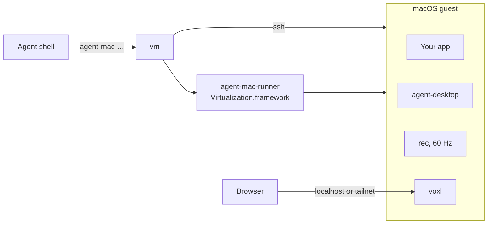

# agent-mac

Headless macOS guests for AI agents: install a Mac app, drive it with agent-desktop, record it at 60 fps, and let people watch or take over in a browser.

<p>
  <a href="https://github.com/bmcreations/agent-mac/releases"></a>
  <a href="LICENSE"></a>
  
</p>

UI checks run in the guest, so they leave the host's display, pointer and keyboard to the person at the Mac, and they keep running while the host screen is locked. The guest runs on Apple's Virtualization.framework through a small runner in this repo, installed from Apple's own restore image. Nobody clicks through Setup Assistant.

## Install

```sh
brew install bmcreations/tap/agent-mac
sudo -v          # provisioning writes to the guest's disk as root
agent-mac up
```

The first `agent-mac up` downloads the newest restore image Apple offers (about 25 GB, resumable), installs it, and builds a prepared guest with Homebrew and voxl. That takes half an hour or more, once. After that a new guest is up in about 20 seconds.

## Quick start

```sh
agent-mac install path/to/App.app "abc1234"   # copy a build in, with a label
agent-mac run                                 # launch it and wait for its window
agent-mac ad find --app App --name Open --first   # agent-desktop in the guest
agent-mac ad click <ref_id from find>
agent-mac down
```

Clicking, typing and reading the screen are [agent-desktop](https://agent-browser.dev/desktop)'s job: `agent-mac ad` passes its arguments straight to it inside the guest. `agent-mac ad skills get desktop` prints its guide for the installed version.

To check motion rather than a still state, record around the action:

```sh
agent-mac record start 30
agent-mac ad click <ref>
agent-mac record stop ./recordings open-panel   # .mov, .ticks.json, .fps.json, .actions.json
```

`open-panel.actions.json` lines each `agent-mac ad` call up with the frames, so you can see when the screen first changed after the click.

For runs that compare, fix the guest's screen, look and language, and keep a snapshot to start from:

```sh
agent-mac up --display 1440x900 --appearance dark --locale de_DE
agent-mac save logged-in        # memory and disks; the guest stops
agent-mac restore logged-in     # back to that moment, as often as you like
```

## How it works



- `agent-mac-runner` installs the restore image and runs the guest without a window.
- `provision` writes the setup onto the stopped guest's disk from the host: the admin user, your ssh key, autologin, and the Accessibility and Screen Recording grants.
- Every command after that runs in the guest over ssh. Guests are APFS copies of one prepared guest, so a new one takes almost no disk.

## For AI agents

The repo ships two skills: `agent-mac` for driving an app in a guest, and `record-and-verify` for judging motion from a recording. In Claude Code:

```
/plugin marketplace add bmcreations/agent-mac
/plugin install agent-mac@agent-mac
```

With skills.sh:

```sh
npx skills add https://github.com/bmcreations/agent-mac --skill agent-mac --skill record-and-verify
```

Or add this to your project's `AGENTS.md`:

```md
Check Mac UI in an agent-mac guest, never on the host's own screen. Before the
first use, read `$(brew --prefix agent-mac)/share/agent-mac/skills/agent-mac/SKILL.md`
and follow it. Exit code 3 means a person has control in `agent-mac view`: wait.
```

## Commands

| Group | Commands |
|---|---|
| Guest | `up`, `down`, `save`, `restore`, `prepare`, `status`, `ssh` |
| App | `install`, `run`, `quit` |
| Drive | `ad` (agent-desktop in the guest) |
| Capture | `record start`, `record stop`, `shot`, `vsync` |
| People | `view`, `view --control` (agents give way), `view --remote`, `view stop` |
| Network | `forward-host` |

Every command, with its arguments and output: [docs/commands.md](docs/commands.md).

## Requirements

| Need | Why |
|---|---|
| Apple silicon Mac, macOS 14 or later | Virtualization.framework macOS guests |
| Xcode Command Line Tools | the host scripts use `python3` |
| `sudo` on the host | `provision` mounts the guest's disk and writes root-owned files |
| About 25 GB, plus what each guest fills | the restore image; guest disks are sparse |

macOS runs at most two macOS guests at a time.

## Documentation

- [Quick start](docs/quick-start.md): one app from install to a recording
- [Commands](docs/commands.md): every command, its arguments and output
- [Guests](docs/guests.md): the prepared guest, several guests, sizes, host sleep, reaching host services
- [Watching and taking over](docs/viewing.md): `vm view`, control, tailnet access
- [Recording](docs/recording.md): the 60 Hz recorder, ticks, and what a guest can and can't measure
- [Provisioning](docs/provisioning.md): what gets written to the guest, and why
- [Troubleshooting](docs/troubleshooting.md)
- [AGENTS.md](AGENTS.md): for agents changing this repo

## Development

```sh
make runner      # build and sign the runner with the virtualization entitlement
./vm up          # from a checkout, state goes in .vm/ instead of ~/.agent-mac
```

Pushing a `v*` tag builds the release tarball in GitHub Actions, and the Homebrew formula installs that tarball.

## License

MIT. voxl, which each guest builds from source, is MIT but links x264 (GPL), so agent-mac never ships a voxl binary.
