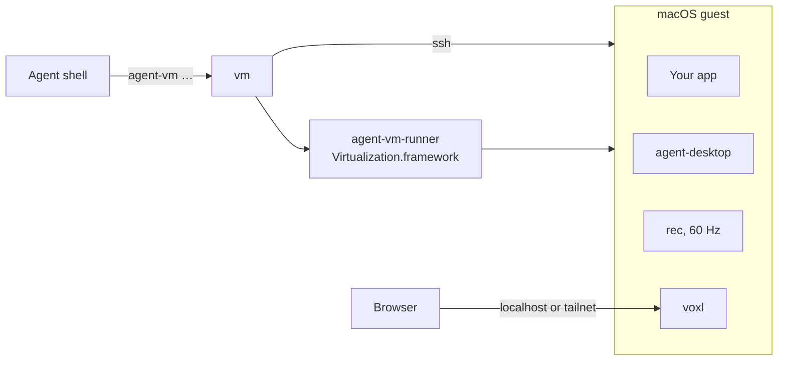

# agent-vm

Headless macOS guests for AI agents: install a Mac app, drive it with agent-desktop, record it at 60 fps, and let people watch or take over in a browser.

<p>
  <a href="https://github.com/bmcreations/agent-vm/releases"></a>
  <a href="LICENSE"></a>
  
</p>

UI checks run in the guest, so they leave the host's display, pointer and keyboard to the person at the Mac, and they keep running while the host screen is locked. The guest runs on Apple's Virtualization.framework through a small runner in this repo, installed from Apple's own restore image. Nobody clicks through Setup Assistant.

## Install

```sh
brew install bmcreations/tap/agent-vm
sudo -v          # provisioning writes to the guest's disk as root
agent-vm up
```

The first `agent-vm up` downloads the newest restore image Apple offers (about 25 GB, resumable), installs it, and builds a prepared guest with Homebrew and voxl. That takes half an hour or more, once. After that a new guest is up in about 20 seconds.

## Quick start

```sh
agent-vm install path/to/App.app "abc1234"   # copy a build in, with a label
agent-vm run                                 # launch it and wait for its window
agent-vm ad find --app App --name Open --first   # agent-desktop in the guest
agent-vm ad click <ref_id from find>
agent-vm down
```

Clicking, typing and reading the screen are [agent-desktop](https://agent-browser.dev/desktop)'s job: `agent-vm ad` passes its arguments straight to it inside the guest. `agent-vm ad skills get desktop` prints its guide for the installed version.

To check motion rather than a still state, record around the action:

```sh
agent-vm record start 30
agent-vm ad click <ref>
agent-vm record stop ./recordings open-panel   # open-panel.mov, .ticks.json, .fps.json
```

## How it works



- `agent-vm-runner` installs the restore image and runs the guest without a window.
- `provision` writes the setup onto the stopped guest's disk from the host: the admin user, your ssh key, autologin, and the Accessibility and Screen Recording grants.
- Every command after that runs in the guest over ssh. Guests are APFS copies of one prepared guest, so a new one takes almost no disk.

## For AI agents

The repo ships two skills: `agent-vm` for driving an app in a guest, and `record-and-verify` for judging motion from a recording. In Claude Code:

```
/plugin marketplace add bmcreations/agent-vm
/plugin install agent-vm@agent-vm
```

With skills.sh:

```sh
npx skills add https://github.com/bmcreations/agent-vm --skill agent-vm --skill record-and-verify
```

Or add this to your project's `AGENTS.md`:

```md
Check Mac UI in an agent-vm guest, never on the host's own screen. Before the
first use, read `$(brew --prefix agent-vm)/share/agent-vm/skills/agent-vm/SKILL.md`
and follow it. If a person has control in `agent-vm view`, stop sending input.
```

## Commands

| Group | Commands |
|---|---|
| Guest | `up`, `down`, `prepare`, `status`, `ssh` |
| App | `install`, `run`, `quit` |
| Drive | `ad` (agent-desktop in the guest) |
| Capture | `record start`, `record stop`, `shot`, `vsync` |
| People | `view`, `view --control`, `view --remote`, `view stop` |
| Network | `forward-host` |

Every command, with its arguments and output: [docs/commands.md](docs/commands.md).

## Requirements

| Need | Why |
|---|---|
| Apple silicon Mac, macOS 14 or later | Virtualization.framework macOS guests |
| Xcode Command Line Tools | the host scripts use `python3` |
| `sudo` on the host | `provision` mounts the guest's disk and writes root-owned files |
| About 25 GB, plus what each guest fills | the restore image; guest disks are sparse |

macOS runs at most two macOS guests at a time.

## Documentation

- [Quick start](docs/quick-start.md): one app from install to a recording
- [Commands](docs/commands.md): every command, its arguments and output
- [Guests](docs/guests.md): the prepared guest, several guests, sizes, host sleep, reaching host services
- [Watching and taking over](docs/viewing.md): `vm view`, control, tailnet access
- [Recording](docs/recording.md): the 60 Hz recorder, ticks, and what a guest can and can't measure
- [Provisioning](docs/provisioning.md): what gets written to the guest, and why
- [Troubleshooting](docs/troubleshooting.md)
- [AGENTS.md](AGENTS.md): for agents changing this repo

## Development

```sh
make runner      # build and sign the runner with the virtualization entitlement
./vm up          # from a checkout, state goes in .vm/ instead of ~/.agent-vm
```

Pushing a `v*` tag builds the release tarball in GitHub Actions, and the Homebrew formula installs that tarball.

## License

MIT. voxl, which each guest builds from source, is MIT but links x264 (GPL), so agent-vm never ships a voxl binary.
